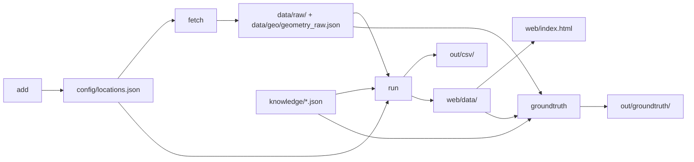

# SEFT: social-ecological systems of micro-watersheds from CoRE Stack data

This repository turns CoRE Stack micro-watershed (MWS) and village data into:

1. **Indicators** per MWS: means, trends, variability and co-incident changes.
2. **Context classes**: rainfall regime, aquifer, terrain, groundwater category and canal access.
3. **A mixture of system archetypes** per MWS: rainfed dryland, rainfed sub-humid, groundwater-, canal- and tank-irrigated, forest fringe, tree crops, pastoral, peri-urban.
4. **Observed stresses and opportunities** per production system (agriculture, livestock and commons, forest, peri-urban, and the cross-cutting socio-economic system of households). Each observed stress is made of causal pathways: rules written over a library of system, stress and context signals, nested where they share a mechanism (`groundwater.over_extraction`), with an intensity from 0 to 100, a plain-language public note, and re-assessment with community answers.
5. **Matching central and state schemes**, and village clusters (each village goes to the MWS it overlaps most).

All logic and metadata sit in `knowledge/*.json`, so domain experts can review and edit them without touching code.
The repository ships with results for eight test districts, so the atlas opens straight away.

## Documentation in this repo

* [knowledge/README.md](knowledge/README.md) — how to edit watershed indicators, contexts, archetypes, signals, rules, schemes and community questions.
* [knowledge/waterbody/README.md](knowledge/waterbody/README.md) — the same for the waterbody atlas (types, variables, signals, roles, rules).
* [config/README.md](config/README.md) — `locations.json`, `datasets.json` and `counts.json`.
* [config/groundtruth/](config/groundtruth/) — labelled MWS (`final_ground_truth.json`), pathway map (`pathways.json`), [changes made](config/groundtruth/changes.md) and [pathway-by-pathway notes](config/groundtruth/suggestions.md).
* [docs/core_stack_api_issues.md](docs/core_stack_api_issues.md) — CoRE Stack API caveats (CS-01 …) that affect watershed results.
* [docs/core_stack_waterbody_api_issues.md](docs/core_stack_waterbody_api_issues.md) — waterbody GeoServer layers (WB-01 …).
* [docs/waterbody_census_comparison.md](docs/waterbody_census_comparison.md) — how the Water Body Census fields were compared with the rules (they are never inputs).
* [docs/core-seft-plan.md](docs/core-seft-plan.md) — plan for the `core-seft` library (analyse district / tehsil / MWS / waterbody).
* [docs/core-seft.md](docs/core-seft.md) — user README for the `core-seft` library (install, `analyse`, knowledge packs, notebooks).

## Quick start: open the atlas

Open `web/index.html` in a browser. It works directly from disk, or you can serve it with
`python -m http.server -d web 8000` and open http://localhost:8000.

The atlas covers Pune, Amaravati, Ananthapur, Srikakulam, Godda, Koraput, Udaipur and Ballia:
73 tehsils and 4,598 MWS. The same results are in `out/csv/` as tables.

## Running for new locations

```bash
python -m pip install -r requirements.txt
export CORE_STACK_API_KEY=...            # your CoRE Stack key; never commit it
export CORE_STACK_API_VERSION=v2          # optional; v2 is the default and serves every dataset

# 1. say where (names exactly as the CoRE Stack API lists them) and what for (--role, below)
python -m seft.cli add --state Maharashtra --district Yavatmal --tehsils "Darwha,Pusad,Arni,Digras" --role coverage

# 2. download, check, analyse
python -m seft.cli fetch                 # API data + GeoServer geometry; cached datasets are skipped
python -m seft.cli audit                 # lists anything missing or incomplete
python -m seft.cli run                   # writes out/csv, out/web and web/data (the atlas data)
# or all three at once:  python -m seft.cli all
```

On Windows, use `python -m pip` rather than `pip`. Windows Application Control often blocks `.venv\Scripts\pip.exe`. After `py -m venv .venv` and `.\.venv\Scripts\Activate.ps1`, run `python -m pip install -r requirements.txt`. If `python` is not on PATH in that shell, use `.\.venv\Scripts\python.exe -m pip install -r requirements.txt`. Set the API key in PowerShell with `$env:CORE_STACK_API_KEY = "..."` and, if needed, `$env:CORE_STACK_API_VERSION = "v2"`. These last only for that session.

Open `web/index.html` again: new districts appear on the India map and in the district list.
No HTML changes are needed.

### Location roles

Every district in a locations file carries `roles`, which say what it is for:

| Role | Meaning | Districts now |
|---|---|---|
| `pools` | The sample for the percentile pools: the thresholds of every pooled signal are percentiles over these MWS (watersheds) or waterbodies (waterbodies). | The eight original districts (Pune, Amaravati, Ananthapur, Srikakulam, Godda, Koraput, Udaipur, Ballia), in both `config/locations.json` and `config/waterbody/locations.json`. |
| `groundtruth` | Compared with independent labels. Watersheds: the tehsils of `final_ground_truth.json`, in `config/groundtruth/locations.json` (rebuilt by `groundtruth`). Waterbodies: the Water Body Census fields matched by CoRE Stack (`wb-census`). | 29 ground-truth districts (watersheds); the eight original districts for the census comparison (run on 22 Nov 2026). |
| `coverage` | Extra districts fetched to extend the atlas, or cached on demand by `core_seft` (listed in `data/index.json`). Scored with the published pools; never used to compute them. | Chittoor, Hazaribagh. |

`knowledge/pools.json` records under `provenance` which districts its MWS and waterbody pools were computed
over. **The published pools (24 Nov 2026) were computed over all ten districts**, because the run that added
Chittoor and Hazaribagh pooled over every district before roles existed. `run --update-pools` (and
`wb-run --update-pools`) recompute them over the eight `pools` districts only.

```bash
python -m seft.cli add --state ... --district ... --tehsils "..." --role coverage      # default
python -m seft.cli add --state ... --district ... --tehsils "..." --role pools          # joins the pools sample
python -m seft.cli add --state ... --district ... --tehsils "..." --role groundtruth    # -> config/groundtruth/locations.json
python -m seft.cli wb-add --state ... --district ... --tehsils "..." --role pools,groundtruth
```

Adding a role to a district already listed keeps its other roles (a `coverage` district given `pools` becomes
`pools` only).

Which thresholds a run uses:

* **By default `run` and `wb-run` score with the published pools** in `knowledge/pools.json`, whichever districts
  are in the run. A new `coverage` district therefore gets exactly the thresholds of the atlas:
  ```bash
  python -m seft.cli add --locations config/yavatmal.json --state Maharashtra --district Yavatmal --tehsils "..."
  python -m seft.cli all --locations config/yavatmal.json --merge
  ```
  `--merge` keeps the districts already in `web/data/`, and `mws_all.csv` and `villages_all.csv` are rebuilt to
  include every district.
* **`--update-pools`** recomputes the pools over the `pools` districts of the locations file (their raw data
  must be cached), writes them and their provenance to `knowledge/pools.json`, and scores every district of the
  run with them. Use it after adding or removing a `pools` district, with a locations file that holds every
  district (`python -m seft.cli run --update-pools`), so that no district keeps the old thresholds. With
  `--merge`, districts kept from the atlas were scored with the previous pools; the command says so. Bump
  `knowledge/manifest.json` before releasing a knowledge pack with new pools.
* If `knowledge/pools.json` has no pools yet, the first run computes them over the `pools` districts.

The same flow, with the files each step writes:



## What the commands do

Every command is `python -m seft.cli <name>`. `--locations FILE` (default `config/locations.json`) is the worklist of districts and tehsils. `--knowledge` defaults to `knowledge/`, `--out` to `out/`.

### `add`

Creates or updates a locations file so later commands know where to work.

* **Reads:** `--locations` if it already exists (`{"districts": [...]}`).
* **Writes:** the same file. Adds a district if it is new, otherwise appends tehsils that are not already listed. Names must match the CoRE Stack API (`get_active_locations`), including hyphens (`Mulshi-Paud`).
* **Used by:** `fetch`, `audit`, `run` and `all` as the list of places to download and analyse. The atlas district list is not updated until `run` writes `web/data/index.json`.

```bash
python -m seft.cli add --state Maharashtra --district Yavatmal --tehsils "Darwha,Pusad,Arni,Digras"
# or a separate file:  --locations config/yavatmal.json
```

### `fetch`

Downloads CoRE Stack data for every tehsil in the locations file. Cached complete files are skipped unless `--force`. `--only lulc_vector` fetches a single dataset.

* **Reads:** `config/locations.json` (or `--locations`), `config/datasets.json` (which datasets, MWS vs village), any existing `data/geo/geometry_raw.json` and `data/raw/...` caches, and `data/geo/geoserver_backfill.json` (stored GeoServer rows for the test districts).
* **Writes:**
  * `data/geo/geometry_raw.json` — MWS polygons, village points and tehsil outlines, keyed `district_slug/tehsil_slug`. The MWS count is the expected row count for MWS-level datasets. `run` later copies these polygons into the atlas bundles.
  * `data/raw/<state>/<district>/<tehsil>/_response.json.gz` — the tehsil's full API response (presigned S3 links stripped). A dataset added to `config/datasets.json` later is extracted from this file with no new API call.
  * `data/raw/<state>/<district>/<tehsil>/<dataset>.json` — one cache file per dataset, with `rows`, `complete`, `n_rows` and `expected_mws`. These are the only raw inputs `run` needs.
* **Used by:** `load.py` during `run` and `groundtruth`; `audit` to list gaps. `data/raw/` is gitignored and not shipped; without it, use `python -m seft.rescore` on the existing atlas bundles.

What it does, in order:

* **Geometry first.** For each tehsil it downloads MWS polygons and village points from GeoServer (`crop_intensity:{district}_{tehsil}_intensity` and `panchayat_boundaries:{district}_{tehsil}`) into `data/geo/geometry_raw.json`.
* **One request per tehsil.** It calls `/api/v2/get_tehsil_data/` once, without a `data` filter, and splits the response into the datasets in `config/datasets.json`. The filter is not used because it rejects `forest_fire`, `forest_fringes`, `tree_in_grassland` and `ndvi`, which the unfiltered response includes (CS-83). Failed requests are retried. Presigned S3 links in `green_credit` are stripped (CS-62).
* **Back-fill.** A dataset that comes back cut off, or with fewer MWS than the geometry, is marked `complete: false`. Incomplete `lulc_vector` and `croppingintensity_annual` are back-filled from the GeoServer layers behind the API (CS-59). Set `SEFT_NO_GEOSERVER=1` to skip that. Stored rows in `data/geo/geoserver_backfill.json` fill other truncated test-district datasets.
* **Audit.** `python -m seft.cli audit` only reads the cache and prints what is still missing or incomplete. It writes nothing.

The default endpoints can be changed with `CORE_STACK_API_BASE` and `CORE_STACK_GEOSERVER`.

### `run`

Turns the cache and the knowledge files into tables and the atlas. `python -m seft.cli all` is `fetch`, then `validate`, then `run`. `validate` only reads `knowledge/*.json` and checks that every expression parses and every id resolves; it writes nothing.

* **Reads:**
  * `--locations` and every `knowledge/*.json`
  * `data/raw/<state>/<district>/<tehsil>/*.json` (refuses to start if `lulc_vector.json` is missing)
  * `data/geo/geometry_raw.json` and `data/geo/india_states.json` (map outlines)
  * optional `--answers FILE` (`community_answers.json` saved from the atlas)
* **Writes:**
  * `out/csv/mws_<district>.csv` and `villages_<district>.csv`, plus `mws_all.csv` and `villages_all.csv` — one row per MWS or village: indicators, context classes, system shares, pathway and stress status/intensity, schemes, village cluster size.
  * `out/web/index.json` — district summaries, India state outlines, a copy of all nine knowledge files, and the pooled percentile thresholds used in this run.
  * `out/web/d_<slug>.json` — one bundle per district: encoded MWS polygons, tehsil outlines, compact MWS records (indicators, mix, stresses, signals, schemes, village ids) and village rows with coordinates.
  * `web/data/` — the same bundles as both `.json` (for `http://`) and `.js` (for `file://`), plus `web/data/csv/` copies of the tables. This is what `web/index.html` loads. `--no-web` skips the atlas and writes only CSV. `--merge` keeps district bundles already in `web/data/` that this run did not produce, and rebuilds `mws_all.csv` / `villages_all.csv` over every district in the atlas.

Thresholds are the published pools in `knowledge/pools.json` unless `--update-pools` recomputes them over the `pools` districts (see Location roles). After `run`, open `web/index.html`; new districts appear on the India map with no HTML changes.

### Community answers

The atlas lets a field team answer the questions in `knowledge/questions.json` for an MWS and re-assess the stresses in the browser. Save them from the Explore or Data tab as `community_answers.json`. Running `python -m seft.cli run --answers community_answers.json` writes the same posteriors and schemes into `out/csv/` and `web/data/`.

### Commons Connect and must-ask scores

The atlas has a third section, **Commons Connect**, that walks through a field visit for one micro-watershed (state and
district, tehsil, MWS): the landscape, then resource mapping (settlements, waterbodies, wells, crops, forest patches),
then planning of new works and maintenance (groundwater recharge, surface waterbodies, irrigation on farms,
agroforestry and orchards, livelihoods, forests). The micro-watershed is picked on the same map and pickers as
the Watersheds atlas. It shows what the atlas infers first and ranks every question by a
**must-ask score** (0–100): how likely the answer is to change the inference, because a rule is near its threshold,
the data are missing or uncertain, the rule is held with low confidence, or an answer could move a system across its
presence line. Must-ask (60+) and useful (30–59) questions are shown; the rest are collapsed. Answers that match an
atlas question are passed to the atlas at once, so the mix, the stresses, the scores and the ranked work types update
as the visit goes on. The same scores rank the community questions in both atlases' Explore panes.

```bash
python -m seft.cli cc-build --forms <folder with the Commons Connect .xlsx templates>   # -> knowledge/commons_connect.json
python -m seft.cli refresh-knowledge                                                   # -> web/data/commons_connect.{json,js}
python -m seft.cli priority [--district pune]                                          # -> out/priority/<district>.csv
```

* `knowledge/commons_connect.json` is the structured local version of the forms: the 12 ODK templates (English labels,
  options, relevance converted to the atlas expression language, required flags) and the Word drafts that have no
  template yet (the landscape form and the two forest forms). Each question has a `role` (`inform`, scored; `record`,
  such as names, beneficiary details, dimensions and photos), `atlas_match` (the atlas questions it covers: `same`,
  `derived` through a mapping or bands, or `overlap`), `must_ask` (base score and conditions), `prefill` (the answer
  the atlas expects, for the field worker to confirm) and, in planning forms, `work_map` (work types to interventions).
  Every atlas question is asked in some form; the landscape form gets the ones its Word draft lacks.
* `seft/priority.py` computes the scores; the page computes the same in the browser (all 577,296 scores of the
  watershed and landscape questions agree, data alone). `priority` writes one row per MWS and question.

### `rules-xlsx`

`python -m seft.cli rules-xlsx --v1 WaterStructure_Suitability_Rules.xlsx` writes the site rules of
`knowledge/interventions.json` back into the layout of the CoRE Stack suitability-rules workbook
(`out/WaterStructure_Suitability_Rules_v2.xlsx`): the workbook's structures and parameters with the current
values, each row's basis (source, proposed, not sourced, not reviewed), sources and notes; SOURCES; ABOUT. Site layers only (slope, stream order raster, catchment, distance to drainage
line, land use, soil); landscape rules stay in the interventions file.

### `groundtruth`

Scores atlas rules and Signal_Verification sheet rules against labelled micro-watersheds.

```bash
python -m seft.cli groundtruth --truth path/to/final_ground_truth.json
```

The input lists MWS known to have a pathway (`positive`) or not (`negative`), by `block_name` (tehsil) and `uid`. `config/groundtruth/pathways.json` maps each ground-truth pathway to atlas rule ids and a sheet pattern.

* **Reads:** the truth file; `config/groundtruth/pathways.json`; `knowledge/*.json` and `knowledge/sheet_rules.json`; `web/data/index.json` (atlas pooled thresholds, unless `--pools run`); `config/locations.json` when computing sample firing rates; `config/groundtruth/changes.md` and `suggestions.md` (copied into the report).
* **Writes:**
  * `config/groundtruth/active_locations.json` — cache of `get_active_locations` (`--refresh-locations` downloads it again).
  * `config/groundtruth/locations.json` — resolved `{state, district, tehsils}` for the labelled blocks.
  * `config/groundtruth/resolution.json` — how each block name was matched (including ambiguous names settled by uid).
  * `config/groundtruth/final_ground_truth.json` — copy of `--truth` when a different path is passed.
  * `data/raw/...` for those tehsils, through the normal fetcher (`--no-fetch` uses only the cache; `--force` re-downloads).
  * `out/groundtruth/report.md` — confusion tables, combination tables, changes and suggestions.
  * `out/groundtruth/confusion.csv`, `detail.csv` (one row per label with rule results and signals), `combinations.csv`, `results.json`.
  * `out/groundtruth/sample_rates.json` — firing rates over the atlas sample, cached per knowledge version (`--no-sample` skips this).

Steps:

1. **Resolve locations.** Each block name is matched against `get_active_locations` without case. `"Keonjhar (Kendujhar)"` also matches `keonjhar` and `kendujhar`. A name found in more than one district is settled by which tehsil's `lulc_vector.json` contains the listed uid.
2. **Fetch** those tehsils into `data/raw/` like any other location.
3. **Score both rule sets.** Atlas rules use the pooled thresholds from `web/data/index.json` so they match the live atlas (`--pools run` pools over the ground-truth MWS instead). Sheet rules (`knowledge/sheet_rules.json`, built by `tools/build_sheet_rules.py`, evaluated by `seft/sheet.py`) treat signals as 0/1, `or` as a sum and `and` as a product. An atlas pathway is present when any of its rules is triggered; unknown predictions are left out of accuracy.
4. **Report.** Metrics (balanced accuracy, F1), sample firing rates, atlas OR/AND sheet combinations, and a confidence-tier table (how often the label is positive when both, one or neither rule set fires). `python tools/groundtruth_whatif.py` scores candidate rule changes without applying them.

## Waterbody atlas

The waterbody atlas uses the same operations as the watershed atlas, on its own locations file
(`config/waterbody/locations.json`, by default the 73 tehsils of the eight original districts). Each waterbody is
the unit; its landscape context comes from the watershed pipeline through the MWS it lies in, and its villages
are the villages intersecting that MWS.

```bash
python -m seft.cli wb-add --state Maharashtra --district Yavatmal --tehsils "Darwha,Pusad"
python -m seft.cli wb-fetch            # API datasets (as fetch) + GeoServer waterbody and zone-of-influence layers
python -m seft.cli wb-audit            # what is missing per tehsil
python -m seft.cli wb-validate         # check knowledge/waterbody/*.json
python -m seft.cli wb-run [--merge]    # build and score -> out/waterbody/, web/data/waterbody/
python -m seft.cli wb-all              # wb-fetch, wb-validate, wb-run
python -m seft.cli wb-census           # compare with the Water Body Census fields -> out/waterbody/census/
```

* **`wb-add`** writes to `config/waterbody/locations.json` (or `--locations`), exactly like `add`, with `--role`
  (`pools`, `groundtruth` for the census comparison, `coverage`).
* **`wb-run`** scores with the published waterbody pools; `--update-pools` recomputes them over the `pools`
  districts and writes `knowledge/pools.json`.
* **`wb-fetch`** runs `fetch` for the same tehsils (cached datasets are skipped), then downloads
  `swb:surface_waterbodies_{district}_{tehsil}` and `swb:waterbodies_zoi_{district}_{tehsil}` from
  `CORE_STACK_GEOSERVER` into `data/raw/<state>/<district>/<tehsil>/swb_layers.json.gz` (attributes, yearly
  series, centroid, bounding box and a simplified polygon per waterbody; centre, radius and yearly cropping per
  zone of influence). GeoServer is on port 8443, so run it where that port is reachable.
* **`wb-audit`** lists, per tehsil, the cached layers, waterbody and zone counts, whether zones carry `wb_id`
  (WB-02) or must be matched by location, old layers without drainage fields (WB-10), and missing API datasets.
* **`wb-run`** (`seft/wb/run.py`):
  1. merges fragments of one waterbody (same `area_ored` and yearly series, polygons within about 30 m; WB-01),
     drops waterbodies under 0.05 ha, joins each zone of influence on `wb_id` or, where the zone layer lacks
     it, by location (centre distance and radius for size), and assigns a type (`knowledge/waterbody/types.json`);
  2. runs the watershed pipeline for the same tehsils, with the atlas's pooled thresholds from
     `web/data/index.json`, and gives each waterbody its home MWS's context dimensions, archetype shares and
     variables;
  3. adds village fishery and irrigation-source shares (Mission Antyodaya) and MWS drought years from the cached
     API files, computes the waterbody variables, and scores signals, roles and rules (`knowledge/waterbody/`);
  4. writes `out/waterbody/csv/wb_<district>.csv` (one row per waterbody; rule columns: blank = not applicable,
     0 = not triggered, NA = insufficient data, otherwise the intensity), `out/waterbody/web/index.json`
     (knowledge, districts, firing rates, pooled thresholds) and `out/waterbody/web/w_<district>.json`, and copies
     the bundles and tables to `web/data/waterbody/` (`--merge` keeps districts this run does not cover;
     `--no-web` skips the copy).
     Each waterbody also gets a **status**: `regular` (wet in 3 or more of the 8 years and not new), `rarely_wet`
     (wet in 1 or 2 years; rules needing several wet years do not apply) or `new` (first wet in 2022 or later and
     wet every year since, mostly recently dug farm ponds). New waterbodies are counted per home MWS as **recent
     ponds** (`mws_recent_ponds` in the CSV, `recent_ponds` in the bundle's MWS table), a positive sign of where
     pond-building schemes have reached. The `schemes` column lists the schemes linked to the triggered rules
     (`knowledge/waterbody/schemes.json`, filtered by state and type).
* **`wb-assess --answers waterbody_answers.json`** (`seft/wb/assess.py`) applies community answers saved from the
  page: type answers (ownership, inflow) reassign the type and re-score every rule; stress answers multiply each
  rule's odds by their likelihood ratios. Writes `out/waterbody/answers/assessed.csv`.
* **`wb-census`** (`seft/wb/census.py`) scores the `groundtruth` districts of the waterbody locations file (`--all`
  for every district) with the published pools and compares them with the Water Body Census fields that CoRE
  Stack matched to them, as `groundtruth` does for watersheds. The comparison of 22 Nov 2026 covered the eight
  original districts. It writes
  `out/waterbody/census/report.md`, `detail.csv` and `comparison.json`. The census fields are never inputs.
  Decisions taken from it are in `docs/waterbody_census_comparison.md`.

## How the frontend works

The page has two atlases, switched at the top: **Watersheds** (described below) and **Waterbodies**. The waterbody
atlas loads `web/data/waterbody/index.json` and `w_<district>.json` (or `wb_index.js` / `wb_w_<district>.js` from
disk) and draws each district's MWS and tehsil outlines from the watershed bundle `d_<district>`. Its tabs: Explore
(map coloured by type, status, recent ponds, any rule or role; district, MWS and waterbody records with the fill
series, how the type was assigned, roles, rules with their signals, community questions that re-compute the type and
re-assess the stresses, and schemes), Knowledge graph, Waterbody types, Observed stresses (with the signal library,
roles and each rule's questions and likelihood ratios), Community questions, Schemes, Methodology and Data. The page
scores a waterbody again after a type answer with a JavaScript mirror of `seft/wb/build.py` and `seft/wb/score.py`;
for that the bundles carry each waterbody's variables (`e`, index `env_ids`) and type fields (`tf`), and the MWS table
the home-MWS values the rules read (`mws_ids`). Add `?atlas=wb` to open it directly.

`web/index.html` is a single-page atlas. It does not read `knowledge/` or `data/raw/` itself. Everything it needs is written into `web/data/` by `run` (via `seft/webdata.py`).

**Boot.** On load it calls `loadData("index")`:

* over `http://` or `https://`, it fetches `web/data/index.json`;
* over `file://` (opened from disk), browsers block `fetch`, so it loads `web/data/index.js`, which assigns the same object to `window.SEFT_DATA["index"]`.

`index.json` holds:

* `districts` — name, slug, state, tehsil list, outline, bounds, area-weighted system mix, stress rates, top schemes (drives the India map and the district picker);
* `states` — India state outlines, copied from `data/geo/india_states.json`;
* `knowledge` — a snapshot of all nine `knowledge/*.json` files (tabs, labels, questions, scheme text, methodology);
* `pools` and `signal_thresholds` — the percentile cut-offs used when this atlas was built.

**District data.** Choosing a district calls `loadBundle(slug)`, which loads `web/data/d_<slug>.json` (or `.js`). That bundle has encoded MWS polygons (`m.g`), tehsil outlines, compact MWS records (indicators `i`, context `c`, mix `m`, stresses `s`, signal grades `sg`, schemes `sc`, village ids `v`) and village rows with lon/lat. Geometry uses the same delta encoding as `seft/geo.py` (`decode()` in the page). Bundles stay in memory (`BUNDLES`) so switching tehsils does not reload.

**Tabs.** Explore (map + reading pane), Data (CSV downloads from `web/data/csv/mws_*.csv` and `villages_*.csv`), Knowledge graph, System archetypes, Stress rules, Community questions, Schemes, Methodology. The last five render only from `IDX.knowledge`; they do not hit the network again.

**In-browser scoring.** The block between `/*CORE-START*/` and `/*CORE-END*/` mirrors `seft/expr.py`, `archetypes.py`, `signals.py` / `stresses.py`, `assess.py` and `schemes.py`. Community answers therefore re-score mix, stresses and schemes in the page without Python. Keep that block in step when changing those modules. Answers stay in the browser until saved as `community_answers.json` and passed to `run --answers`.

**Without a rebuild.** Editing `knowledge/*.json` does not change the page until `run` (or `python -m seft.rescore`) rewrites `web/data/index.json`. `rescore` reuses indicators, contexts and mix already stored in the bundles, so it does not need `data/raw/`.

## Layout

```
config/
  locations.json      districts and tehsils to analyse (edit, or use `seft.cli add`)
  datasets.json       get_tehsil_data datasets and whether they are MWS- or village-level
  counts.json         MWS and village counts of the test tehsils (reference)
  groundtruth/        labelled MWS, pathway map, location resolution (see groundtruth command)
knowledge/            all logic and metadata, editable by experts (see knowledge/README.md)
seft/                 Python package (walkthrough below)
tools/                sheet-rule compiler and ground-truth what-if
data/
  geo/                MWS, village and tehsil geometry, India state outlines, GeoServer back-fill of the test districts
  raw/                downloaded API data (created by fetch; not shipped)
out/csv/              result tables (mws_<district>.csv, villages_<district>.csv, *_all.csv)
out/groundtruth/      confusion matrices and detail from the groundtruth command
out/priority/         must-ask scores per MWS and question (priority command)
out/WaterStructure_Suitability_Rules_v2.xlsx   site rules in the workbook layout (rules-xlsx command)
out/web/              atlas bundles before they are copied to web/data (gitignored)
web/
  index.html          the atlas
  data/               atlas data: index + one bundle per district, as .json and .js, and the CSV tables
docs/                 CoRE Stack API issues log (CS-01 to CS-73)
tests/test_offline.py add -> fetch -> audit -> validate -> run against a mock CoRE Stack server
```

## Code walkthrough

Read the files in this order. It is the path a new location takes from a tehsil name to a pixel on the map.

### 1. Config and knowledge (what you edit)

Nothing in `seft/` hard-codes a district, an indicator or a rule. Locations live in `config/locations.json`. Which API datasets to cache is `config/datasets.json`. Every formula, threshold, system share, stress rule, scheme and community question is a JSON file in `knowledge/` (`knowledge/README.md` is the editing guide). `config/counts.json` is a reference table of test-tehsil MWS counts; the pipeline does not read it.

### 2. Entry point — `seft/cli.py`

`python -m seft.cli` is the only command you need day to day. It parses subcommands and calls the modules below. `add` writes the locations file itself. `fetch` / `audit` / `validate` / `run` / `groundtruth` import the matching module. `all` is fetch, then validate, then run.

### 3. Shared helpers — `seft/util.py`

Repository root, JSON load/save, `slug` (cache path names) and `gs_slug` (GeoServer layer names, which keep hyphens). `raw_dir(state, district, tehsil)` is `data/raw/<slug>/<slug>/<slug>/`. `iter_locations` walks the locations file.

### 4. Download — `seft/fetch.py`, `geo.py`, `ingest.py`, `schema.py`, `backfill.py`

`fetch.py` is the driver described under `fetch` above: GeoServer geometry, one unfiltered API request per tehsil, split into dataset files, completeness checks, live GeoServer back-fill of truncated LULC and cropping intensity.

* `geo.py` encodes Shapely polygons as compact integer delta-rings. The same encoding is stored in `geometry_raw.json`, copied into atlas bundles, and decoded in `web/index.html`.
* `ingest.py` turns a `get_tehsil_data` JSON (or a string cut off at the MCP size limit) into `{dataset: (rows, units, complete)}`. `python -m seft.ingest` can parse a saved MCP response by hand.
* `schema.py` maps the documented API column names (unit suffixes, `DeltaG_in_mm_2017-2018`) onto the internal names the knowledge files use (`hydro.delta_g`). It accepts both the nested v1-style rows and the flat v2 rows.
* `backfill.py` applies `data/geo/geoserver_backfill.json` to incomplete test-district caches (hydrology, livestock, and similar) after the live fetch.

### 5. Coverage check — `seft/audit.py`

Reads each required dataset file in `data/raw/` and prints `missing` / `incomplete:n/expected` / `ok`. Use it after `fetch` and before `run`.

### 6. Cache → one record per MWS — `seft/load.py`

This is the join step. For each tehsil it reads the cached JSON files, aliases datasets (`lulc_vector` → `lulc`, `hydrological_annual` → `hydro`, …), turns yearly columns into numpy series on 2017–2024, and builds village tables. An MWS that straddles tehsils appears in several responses, sometimes with different values (CS-63); `load_district` keeps the copy from the home tehsil (largest village-area overlap) and records the others in `tehsils`. Village census and livestock values are apportioned to MWS by intersection area for indicators, and each village is assigned to the MWS it overlaps most for the cluster list.

### 7. Expression language — `seft/expr.py`

Every `expr` / `share` / `trigger` / `condition` in the knowledge files is evaluated here. Only arithmetic, comparisons, `and`/`or`/`not`, attribute access (`lulc.tree_forest_area`), `in`, and a whitelist of functions (`mean`, `slope`, `div`, `ramp`, …) are allowed, so a JSON file cannot run arbitrary code. Series are numpy arrays; missing values are NaN and propagate as unknown.

### 8. Analysis pipeline — `seft/pipeline.py` and the stage modules

`pipeline.run` is three passes over every MWS in the locations file:

1. **Indicators** (`indicators.py` + `knowledge/variables.json`). Expressions over the loaded datasets, in dependency order. Village-based values are blanked when villages with data cover less than 20% of the MWS. District rainfall is then rescaled to the normals in `contexts.json` (`rain_norm`); Pune is left unscaled.
2. **Contexts and system mix** (`context.py`, `archetypes.py`). Each MWS gets one class per dimension (rainfall regime, aquifer, terrain, groundwater category, canal access). Helpers and share rules split the MWS area among archetypes and close the shares to 100%. Community answers can override helpers or shift share (`assess.system_overrides`).
3. **Signals, stresses, schemes** (`signals.py`, `stresses.py`, `assess.py`, `schemes.py`). Pooled percentiles are computed once over the whole run. Each signal grades 0–1; rules in `causal_graph.json` combine them (`systems` gate, `trigger`, `intensity` 0–100) and `taxonomy.json` rolls them up to observed stresses inside production systems. `assess.py` turns status + intensity + confidence into a prior and updates it with answer likelihood ratios. `schemes.py` matches central and state schemes to triggered stresses, state, eligibility condition and archetype share.

`pipeline.score` is the per-MWS last step; `rescore.py` and `groundtruth.py` call it on records that already have indicators.

### 9. Outputs — `seft/export.py` and `seft/webdata.py`

`export.write_csv` writes the wide MWS and village tables. `export.write_web` builds `out/web/index.json` and `d_<slug>.json`, packing knowledge, geometry and results. `webdata.build` copies those bundles to `web/data/` as `.json` and `.js` and combines per-district CSVs into `mws_all.csv` / `villages_all.csv`. `--merge` is implemented here: existing `d_*.json` whose district is not in the new index are kept. `python -m seft.webdata` re-copies `out/web` if you need to, without re-running the analysis.

### 10. Atlas — `web/index.html`

See [How the frontend works](#how-the-frontend-works). After `run`, this is the only file a reader opens.

### 10b. Commons Connect — `seft/odk.py`, `seft/commons_connect.py`, `seft/priority.py`

`odk.py` reads an ODK XLSForm. `commons_connect.py` holds the form list, the landscape and forest forms written out
from the Word drafts, and the annotations (roles, atlas matches, must-ask rules, prefills, work types) that `cc-build`
adds to the parsed templates. `priority.py` scores atlas and Commons Connect questions (see Commons Connect above).

### 11. Knowledge checks and rescore — `seft/validate.py`, `seft/rescore.py`

`validate.py` walks every expression and id in `knowledge/` (variables, context classes, helpers, shares, signals, graph edges, scheme conditions, question targets, source ids). Run it after editing JSON, before `run`.

`rescore.py` rebuilds stresses, schemes and tables from the indicators already stored in `web/data/`, without `data/raw/`. Use it after changing `signals.json`, `causal_graph.json`, `taxonomy.json`, `questions.json` or `schemes.json`. Variables added since the bundles were built stay missing until the locations are fetched and `run` again.

### 12. Ground truth — `seft/groundtruth.py`, `seft/sheet.py`, `tools/`

`groundtruth.py` is the `groundtruth` command: resolve blocks, fetch, score atlas + sheet, write `out/groundtruth/`. `sheet.py` evaluates `knowledge/sheet_rules.json` (0/1 signals; unknown signals make the trigger `insufficient data` unless every fill-in agrees). `tools/build_sheet_rules.py` regenerates that JSON from the Signal_Verification conventions. `tools/groundtruth_whatif.py` scores candidate atlas expressions against the last ground-truth cache without changing the live rules; results feed `config/groundtruth/suggestions.md`.

### 13. Tests — `tests/test_offline.py`

Starts a mock API and GeoServer serving a synthetic district built on Basantrai (Godda) geometry, copies the repo to a temp directory, and runs `add` → `fetch` → `audit` → `validate` → `run --merge`. The mock truncates `lulc_vector` so the GeoServer back-fill is exercised. No API key or network is needed.

`seft/__init__.py` only holds the package version. `docs/core_stack_api_issues.md` is the numbered log (CS-01 …) of API quirks that the modules above work around.

## Data access

`fetch` calls the CoRE Stack API directly (`https://geoserver.core-stack.org/api/<version>/get_tehsil_data/`)
with the key in the `X-API-Key` header, read from `CORE_STACK_API_KEY`. Both versions work; the loader reads
either response format (`seft/schema.py`). Direct calls return complete data. The MCP server cuts responses at
180,000 characters (CS-84), so use it only for small checks; `python -m seft.ingest` can parse saved MCP
responses if needed. Without network access, `python -m seft.rescore` re-scores the shipped atlas.

## Editing the knowledge

See `knowledge/README.md`. Run `python -m seft.cli validate` after every edit, then `run`. Interventions for both
atlases are in `knowledge/interventions.json` (supply and demand side, with site rules, landscape fit, schemes,
civil-society practice and sources); after editing only their text, `python -m seft.cli refresh-knowledge` updates the
page without re-scoring.
Without the raw API cache, `python -m seft.rescore` re-scores the shipped atlas from its stored indicators
(refreshed 16 Nov 2026). A variable added after that stays missing until the locations are fetched again.

## Testing

`python tests/test_offline.py` starts a mock API and GeoServer serving a synthetic district. It runs the
full new-location workflow on a temporary copy of the repository, including a cut-off `lulc_vector`
response that must be back-filled, and checks that the district is merged into the atlas. No key or
network is needed.

## Method decisions and data caveats

The atlas Methodology tab and `docs/core_stack_api_issues.md` (CS-01 to CS-73) give the full account.
The decisions that most affect results are:

* **Watersheds on tehsil borders.** 972 of the 4,598 test MWS straddle tehsils, and the API returns each copy,
  sometimes with different values (CS-63). Each is counted once, using the copy from its home tehsil
  (the tehsil holding most of its village area).
* **Irrigation.** Non-kharif greenness overstates irrigation in sub-humid districts (CS-70). Groundwater
  irrigation is therefore scaled by the block stage of groundwater extraction, and the remainder counts
  as rainfed second cropping on residual moisture.
* **Rainfall.** CoRE precipitation is smoothed and departs from district normals (CS-68). Rainfall regimes
  use it rescaled to the normals in `knowledge/contexts.json`. Pune is left unscaled.
* **Groundwater change.** Modelled groundwater change (`delta_g`, `welldepth`) is biased strongly negative
  (CS-67). Absolute CGWB water-level thresholds are therefore switched off (`use_absolute: false`) and
  pooled percentiles are used. The block stage of extraction keeps its published 70/90/100% cut-offs.
* **Literacy.** CoRE literacy divides by total population including children aged 0–6 (CS-69), so the
  literacy threshold is lowered to match.
* **System shares.** The shares partition the MWS area. Raw shares below 100% leave the remainder as
  unclassified land in "other"; this happens in 18% of MWS, mostly in hilly tehsils (CS-73). Raw shares
  above 100% are scaled down. Systems at 1% or more are shown. A system is "present" at its own
  threshold (15%; 10% for tank and pastoral; 8% for peri-urban). Rule confidence never scales a share.
* **Community re-assessment.** The data result sets a prior that rises with intensity: triggered 0.60
  to 0.90, not triggered 0.15 to 0.35 (partial evidence), missing data 0.40. Rule confidence pulls the prior toward 0.5
  (high ×1, medium ×0.8, low ×0.6). Answers multiply the odds by likelihood ratios, and a stress counts
  as present at 0.5. The likelihood ratios are expert judgement and should be calibrated against field
  answers.
* **Other API caveats.** `green_credit` rows carry presigned S3 URLs, which are stripped on fetch (CS-62).
  Some responses are truncated; `audit` flags them (CS-59).

The JavaScript in `web/index.html` between `/*CORE-START*/` and `/*CORE-END*/` mirrors `seft/expr.py`,
`archetypes.py`, `signals.py`/`stresses.py` (applicability and pathways), `assess.py` and `schemes.py`. Keep them in step when changing that logic.
